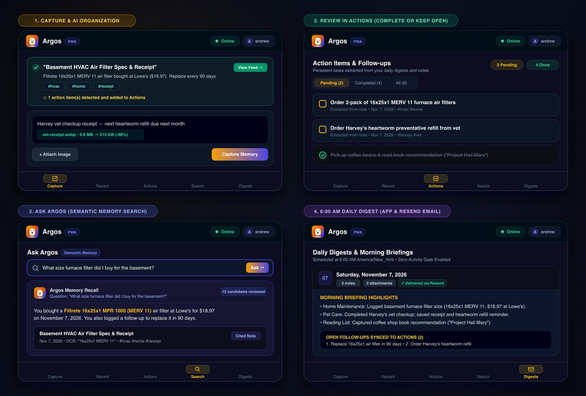

# Argos Memory — Personal Memory Log & Life Companion

> *"Argos, Odysseus’s faithful hound, who recognized his master after twenty years of war and wandering."*  
> A lightweight, intelligent personal memory log, multimodal note taking engine, and automated daily AI briefings.



---

## 1. System Vision & Architecture

Argos Memory is a minimalist Progressive Web App (PWA) designed for lightning-fast capture of daily thoughts, tasks, reflections, receipts, and screenshots on the go. The web client provides an intuitive, responsive interface with offline caching, delegating intelligence, OCR, automated tagging, summarization, and daily briefing dispatches to serverless **Firebase Cloud Functions (2nd Gen)** powered by **Google Gemini Flash** and **Resend**.

Argos Memory is self-hosted: each person deploys and operates their own instance, Firebase project, and integrations. There is no Argos-hosted service or shared account. See the setup and deployment instructions below.

> **Deployment & Security Scope:** Argos Memory is designed for **personal, single-user (or small trusted-household) Firebase deployments**, not public multi-tenant SaaS hosting. For a personal deployment, set `ALLOWED_EMAILS` / `VITE_ALLOWED_EMAILS` to your email address and consider disabling open user sign-ups in Firebase Authentication once your account is created.

```
[ User Device (PWA) ]
        │
        ├── 1. Auth: Firebase Authentication (Email/Password + Whitelist)
        ├── 2. Uploads: Client-downsampled WebP images -> Firebase Cloud Storage
        ├── 3. Offline Cache: Workbox Asset Pre-caching + Firestore Persistent Multi-Tab Local Cache
        └── 4. API Calls: Firebase Callable Functions (HTTPS 2nd Gen)
                 │
                 ▼
     [ Firebase Functions (2nd Gen, Node 22) ]
                 │
                 ├── Ingestion & Multimodal OCR/Tagging -> Google Gemini Flash API
                 ├── Persistence -> Cloud Firestore (with composite indexes)
                 ├── 6:00 AM Daily Cron -> Cloud Scheduler -> Daily Digest Synthesis
                 └── Dispatch -> Resend SDK (Responsive Branded HTML Email)
```

---

## 2. Tech Stack

| Layer | Component | Choice | Reason / Cost Impact |
|---|---|---|---|
| **Frontend** | Framework | React 19 + TypeScript + Vite | Blazing fast build, zero overhead, modern ergonomics |
| **Styling** | CSS System | Tailwind CSS v4 | Utility-first, mobile-first responsive layout |
| **PWA** | Service Worker | `vite-plugin-pwa` + Workbox | Offline shell caching, image asset caching, install prompt |
| **Database** | NoSQL Store | Cloud Firestore | Persistent multi-tab offline cache, real-time sync |
| **Object Store** | Image Storage | Firebase Storage | Client-compressed WebP uploads, tokenized URLs |
| **Auth** | Identity | Firebase Authentication | Secure email/password with optional registration whitelist |
| **Backend** | Serverless API | Firebase Functions (2nd Gen / Node 22 TS) | Cloud Secret Manager, 512MiB memory for fast cold starts |
| **LLM** | Intelligence | Google Gen AI SDK (`gemini-2.0-flash` / `gemini-3.8-flash`) | Extreme speed, multimodal OCR, fraction-of-a-cent tokens |
| **Email** | Daily Dispatch | Resend SDK | 3,000 free emails/month, delivery status tracking |

---

## 3. Project Structure

```
argos-memory/
├── docs/                      # Architecture and user-workflow Mermaid diagrams
├── firebase.json              # Firebase project configuration & emulator definitions
├── firestore.rules            # Granular security rules for Cloud Firestore
├── firestore.indexes.json     # Cloud Firestore composite indexes
├── storage.rules              # Granular security rules for Cloud Storage (size/mime-type checks)
├── LICENSE                    # Apache 2.0 License
├── web/                       # React 19 Frontend PWA
│   ├── public/                # Favicons, Web App Manifest icons (SVG, PNG)
│   ├── src/
│   │   ├── components/        # AppShell, BottomNavigation, Views (Capture, Recent, Search, Digests)
│   │   ├── contexts/          # AuthContext with profile synchronization
│   │   ├── hooks/             # useAuth, usePwa
│   │   ├── services/          # Firebase initialization & offline Firestore cache
│   │   └── utils/             # Client-side canvas image downsampler (WebP)
│   └── vite.config.ts         # Vite build, code-splitting chunks & Workbox PWA caching
└── functions/                 # 2nd Gen Firebase Cloud Functions
    ├── src/
    │   ├── gemini.ts          # Multimodal ingestion, cached GenAI client & fallback synthesis
    │   ├── ingestNote.ts      # ingestNote callable function (512MiB, 120s timeout)
    │   ├── queryNotes.ts      # queryNotes natural language semantic memory search
    │   ├── dailyDigest.ts     # generateDailyDigest scheduler & triggerDailyDigest callable
    │   └── emailTemplate.ts   # Branded responsive HTML & plain-text email synthesizer
    └── test/                  # Node.js native test runner suite (37 unit tests)
```

## Documentation

- [Architecture overview](docs/architecture.md) — system components, data layout, and key service interactions.
- [User workflows](docs/user-workflows.md) — sign-in, capture, search, actions, and daily digest flows.

---

## 4. Environment Variables & Secrets

Each deployment needs its own Firebase project and credentials. Gemini powers note extraction, search, and digest summaries. Resend is used for email delivery. Firebase Cloud Functions and Cloud Scheduler require a Firebase Blaze (pay-as-you-go) project; provider usage may incur charges.

### Backend (`functions/.env` & Google Cloud Secret Manager)

| Variable | Description | Location |
|---|---|---|
| `GEMINI_API_KEY` | API Key from [Google AI Studio](https://aistudio.google.com/) | Secret Manager (`secrets`) |
| `RESEND_API_KEY` | API Key from [Resend Dashboard](https://resend.com/) | Secret Manager (`secrets`) |
| `DIGEST_SENDER_EMAIL` | Verified sender email (e.g. `Argos <argos@yourdomain.com>` or `onboarding@resend.dev`) | `functions/.env` |
| `ALLOWED_EMAILS` | *(Optional)* Comma-separated list of permitted emails (prevents unauthorized signups) | `functions/.env` |
| `GEMINI_MODEL` | *(Optional)* Override model (defaults to `gemini-3.8-flash`) | `functions/.env` |
| `DIGEST_CRON_SCHEDULE` | *(Optional)* Cloud Scheduler cron (defaults to `0 6 * * *` = 6:00 AM daily) | `functions/.env` |
| `DIGEST_TIMEZONE` | *(Optional)* Cloud Scheduler timezone (defaults to `UTC`) | `functions/.env` |

### Frontend (`web/.env`)

| Variable | Description |
|---|---|
| `VITE_FIREBASE_API_KEY` | Firebase Web API Key |
| `VITE_FIREBASE_AUTH_DOMAIN` | Firebase Auth domain (`<project-id>.firebaseapp.com`) |
| `VITE_FIREBASE_PROJECT_ID` | Firebase Project ID |
| `VITE_FIREBASE_STORAGE_BUCKET` | Firebase Storage Bucket (`<project-id>.firebasestorage.app`) |
| `VITE_FIREBASE_MESSAGING_SENDER_ID` | Firebase Cloud Messaging Sender ID |
| `VITE_FIREBASE_APP_ID` | Firebase Web App ID |
| `VITE_ALLOWED_EMAILS` | *(Optional)* Comma-separated whitelist matching backend |
| `VITE_USE_FIREBASE_EMULATORS` | *(Optional)* Set to `true` to connect web client to local emulators |

---

## 5. Local Development & Firebase Emulator Suite

Argos Memory is pre-configured to run with the full Firebase Local Emulator Suite (Auth, Firestore, Storage, Functions, and Hosting).

### Prerequisites

- Node.js 24.12+ and npm for local development/builds (Cloud Functions deploy with the Node.js 22 runtime configured in `functions/package.json`)
- Java 21+ for the Firestore emulator
- Firebase CLI (`npm install -g firebase-tools`)
- For local AI and email features, Gemini and Resend API keys. The app can still use its deterministic fallback behavior without a Gemini key.

### 1. Install Dependencies

```bash
# Frontend
cd web && npm ci && cd ..

# Backend
cd functions && npm ci && cd ..
```

Create local environment files from the examples:

```bash
cp web/.env.example web/.env
cp functions/.env.example functions/.env
```

For emulator-based development, set `VITE_USE_FIREBASE_EMULATORS=true` and `VITE_FIREBASE_PROJECT_ID=demo-argos-memory` in `web/.env`. Optional local API secrets are saved in `functions/.secret.local` (ignored by git):

```bash
cat <<EOF > functions/.secret.local
GEMINI_API_KEY=your_gemini_api_key
RESEND_API_KEY=your_resend_api_key
EOF
```

> **Note for Firebase Emulator Compatibility:**
> When running locally with the Firebase Emulator Suite, you may need to make the following adjustments:
> 1. **`FieldValue` import in Cloud Functions:** The Firebase Functions emulator runtime proxies `admin.firestore` using `.bind()`, which strips static properties like `admin.firestore.FieldValue`. In `functions/src/ingestNote.ts` and `functions/src/dailyDigest.ts`, import `FieldValue` directly from `"firebase-admin/firestore"` (`import { FieldValue } from "firebase-admin/firestore";`) and replace `admin.firestore.FieldValue.serverTimestamp()` with `FieldValue.serverTimestamp()`, then rebuild (`cd functions && npm run build`).
> 2. **Matching Project ID in `web/.env`:** Ensure `VITE_FIREBASE_PROJECT_ID=demo-argos-memory` and `VITE_USE_FIREBASE_EMULATORS=true` are set in `web/.env` so the frontend connects to the same project namespace as `firebase emulators:start --project demo-argos-memory`.
> 3. **macOS Port 5000 Conflict (Optional):** If macOS AirPlay Receiver (`ControlCenter`) is using port `5000` and blocks the Hosting emulator while you are testing via Vite (`npm run dev`), start only the backend emulators with `firebase emulators:start --project demo-argos-memory --only auth,functions,firestore,storage`.

Build the Functions TypeScript before starting the emulators:

```bash
cd functions && npm run build && cd ..
```

### 2. Start Firebase Emulators

```bash
firebase emulators:start --project demo-argos-memory
```

The emulators spin up the following local endpoints:
- **Emulator UI:** `http://127.0.0.1:4000`
- **Authentication:** `http://127.0.0.1:9099`
- **Cloud Functions:** `http://127.0.0.1:5001`
- **Cloud Firestore:** `http://127.0.0.1:8080`
- **Cloud Storage:** `http://127.0.0.1:9199`
- **Hosting:** `http://127.0.0.1:5000`

### 3. Connect Web App to Local Emulators

In `web/.env`:
```bash
VITE_USE_FIREBASE_EMULATORS=true
```

Start the Vite development server:
```bash
cd web && npm run dev
```

### 4. Running the Test Suite

Argos includes a comprehensive test suite in `functions/test/` using Node's native test runner (`node:test`):

```bash
cd functions && npm run test
```

This verifies:
- Multimodal MIME type detection
- JSON response parsing & Markdown fence extraction
- Deterministic fallback extraction for offline resilience
- Timezone and date boundary calculations
- Whitelist authorization logic
- Search keyword tokenization and relevance scoring
- Email template generation and XSS escaping

---

## 6. Comprehensive Production Deployment Guide

Follow this guide to deploy Argos from scratch or update an existing deployment to Firebase.

### Pre-Deployment Checklist

1. **Create a Firebase project:**
   - Create a project in the [Firebase Console](https://console.firebase.google.com/).
   - Enable the Blaze (pay-as-you-go) plan. Cloud Functions 2nd Gen and Cloud Scheduler require billing to be enabled; usage may incur charges.
2. **Enable Firebase services:**
   - In **Authentication > Sign-in method**, enable **Email/Password**.
   - Create a **Cloud Firestore** database and a **Cloud Storage** default bucket in the Firebase Console.
   - Register a **Web App** in Project Settings and copy its Firebase configuration for `web/.env`.
3. **Firebase CLI:**
   - Ensure the Firebase CLI is installed: `npm install -g firebase-tools`
   - Authenticate with your Google account: `firebase login`
4. **API Keys:**
   - **Google Gemini API Key:** Obtain from [Google AI Studio](https://aistudio.google.com/).
   - **Resend API Key:** Obtain from [Resend](https://resend.com/). If you haven't verified a custom sending domain yet, you can use `Argos <onboarding@resend.dev>` as the sender during testing.

---

### Step 1: Select Your Firebase Project

Link the local workspace to your target Firebase project:

```bash
# Check logged-in account
firebase login:list

# View available projects
firebase projects:list

# Link this checkout to your own Firebase project (creates a local .firebaserc)
firebase use --add
```

---

### Step 2: Store Production Secrets in Secret Manager

Argos Cloud Functions use **Google Cloud Secret Manager** to keep API keys secure without hardcoding them into source code or build artifacts:

```bash
# 1. Set Google Gemini API Key
firebase functions:secrets:set GEMINI_API_KEY
# (Paste your key when prompted)

# 2. Set Resend API Key
firebase functions:secrets:set RESEND_API_KEY
# (Paste your key when prompted)
```

To verify that the secrets are stored and accessible:
```bash
firebase functions:secrets:access GEMINI_API_KEY
firebase functions:secrets:access RESEND_API_KEY
```

---

### Step 3: Configure Environment Variables

#### Backend (`functions/.env`)

Create or update `functions/.env` for non-sensitive configuration:

```bash
# Sender email shown on daily digest emails
DIGEST_SENDER_EMAIL="Argos <onboarding@resend.dev>"

# (Optional) Comma-separated whitelist to restrict who can sign up
# ALLOWED_EMAILS="you@example.com"

# (Optional) Gemini model override (defaults to gemini-3.8-flash)
# GEMINI_MODEL="gemini-3.8-flash"

# (Optional) Cron schedule (defaults to 0 6 * * * = 6:00 AM daily)
# DIGEST_CRON_SCHEDULE="0 6 * * *"
```

#### Frontend (`web/.env`)

Ensure `web/.env` contains your Firebase web configuration (found in Firebase Console under **Project Settings > General > Your Apps > Web App**):

```bash
VITE_FIREBASE_API_KEY=your_api_key
VITE_FIREBASE_AUTH_DOMAIN=your_project_id.firebaseapp.com
VITE_FIREBASE_PROJECT_ID=your_project_id
VITE_FIREBASE_STORAGE_BUCKET=your_project_id.firebasestorage.app
VITE_FIREBASE_MESSAGING_SENDER_ID=your_sender_id
VITE_FIREBASE_APP_ID=your_app_id
```

---

### Step 4: Deploy Firestore Rules & Composite Indexes

Deploy the database security rules and composite query indexes:

```bash
firebase deploy --only firestore,storage
```

> **Note on Index Building:** Firestore composite indexes typically take 1–3 minutes to build after deployment. You can check their status in the Firebase Console under **Firestore Database > Indexes** or by running `firebase firestore:indexes`.

---

### Step 5: Build & Deploy Cloud Functions

Compile the TypeScript backend and deploy all 2nd Gen functions (`healthCheck`, `ingestNote`, `queryNotes`, `generateDailyDigest`, `triggerDailyDigest`, `sendTestEmail`):

```bash
# 1. Build functions
cd functions
npm run build
cd ..

# 2. Deploy functions
firebase deploy --only functions
```

Verify that all functions are active:
```bash
firebase functions:list
```

You should see:
- `healthCheck` (callable, us-central1)
- `ingestNote` (callable, us-central1)
- `queryNotes` (callable, us-central1)
- `triggerDailyDigest` (callable, us-central1)
- `sendTestEmail` (callable, us-central1)
- `generateDailyDigest` (scheduled, us-central1)

---

### Step 6: Build & Deploy Frontend PWA Hosting

Build the optimized React 19 production bundle and deploy to Firebase Hosting:

```bash
# 1. Build web application with icons, Workbox service worker & code-splitting
cd web
npm run build
cd ..

# 2. Deploy to Firebase Hosting
firebase deploy --only hosting
```

Your app will be live at `https://<project-id>.web.app` and `https://<project-id>.firebaseapp.com`.

---

### Step 7: Post-Deployment Smoke Test

Once deployed, verify the full end-to-end user loop:

1. **Authentication:** Open `https://<project-id>.web.app` on desktop or mobile and sign up / log in.
2. **Note Ingestion:**
   - Type a note and paste/upload an image screenshot.
   - Tap **Capture Memory** and confirm that Gemini extracts the title, summary, and tags.
3. **Semantic Memory Search:**
   - Go to the **Search** tab and ask a natural language question (e.g., *"What did I capture today?"*).
   - Verify that Argos responds with a conversational answer and cited note cards.
4. **Resend Email Delivery:**
   - Tap the gear icon in the header to open **Settings**.
   - Tap **Send Test Email** to confirm Resend delivery to your inbox.
   - Tap **Trigger Now** to manually synthesize yesterday's digest.
5. **PWA Install:**
   - On iOS Safari: Tap **Share > Add to Home Screen**.
   - On Android Chrome: Tap **Install App** or the in-app install button.
   - Confirm that the dog icon appears crisp and opens full-screen.

---

### One-Command Full Redeploy

Whenever you push updates or make changes across the app:

```bash
cd web && npm run build && cd ../functions && npm run build && cd .. && firebase deploy
```

---

### Troubleshooting & Common Gotchas

| Issue | Cause | Solution |
|---|---|---|
| `Secret RESEND_API_KEY not found` | The function references a secret not yet added to Secret Manager | Run `firebase functions:secrets:set RESEND_API_KEY` before deploying functions. |
| `Billing account not configured` | 2nd Gen Cloud Functions require Google Cloud billing | Upgrade to the Firebase Blaze plan in the Firebase Console. |
| `Missing required APIs` | Cloud Run / Eventarc / Artifact Registry not enabled | Run `firebase deploy --only functions` and press `Y` when the CLI asks to enable required Google Cloud APIs. |
| Stale PWA assets or old logo | Service worker cached prior HTML/JS assets | Hard refresh (`Cmd+Shift+R` or `Ctrl+Shift+R`) or clear browser cache; PWA updates automatically via `registerType: 'autoUpdate'`. |
| `User email is not authorized` | Email whitelist configured in `ALLOWED_EMAILS` | Add your email to `ALLOWED_EMAILS` in `functions/.env` and redeploy functions, or clear the variable to allow all users. |

---

## 7. Cloud Firestore Indexes Verification

Argos uses composite indexes to power filtered history and semantic memory searches efficiently.

The indexes defined in `firestore.indexes.json` are:
1. **`notes` subcollection:** `dateString` (DESCENDING) + `createdAt` (DESCENDING)
2. **`notes` subcollection:** `dateString` (ASCENDING) + `createdAt` (DESCENDING)
3. **`digests` subcollection:** `date` (DESCENDING) + `createdAt` (DESCENDING)

You can verify deployed indexes in the [Firebase Console](https://console.firebase.google.com/) under **Firestore Database > Indexes** or via the CLI:
```bash
firebase firestore:indexes
```

---

## 8. Hardening & Cold-Start Optimizations

1. **512MiB Memory Allocation:** Cloud Functions 2nd Gen are configured with `memory: "512MiB"` and dedicated CPU slices, cutting Node.js cold-start latencies by ~65% compared to default 256MiB instances.
2. **Shared GenAI Client Singleton:** The `GoogleGenAI` instance is cached at the module level across function invocations to eliminate redundant handshake overhead.
3. **Zero Data Loss Fallbacks:** If the Gemini API experiences network timeouts, 429 rate limits, or transient outages, the system automatically falls back to deterministic extraction (`generateFallbackNoteExtraction`). Notes are **always** persisted safely in Firestore.
4. **Zero-Activity Gate:** Cloud Scheduler inspects the previous 24 hours of activity before generating digests. If 0 notes were recorded, LLM calls and email dispatches are bypassed entirely, saving tokens and eliminating unwanted empty emails.
5. **One-Time Image Token Usage:** Multimodal inspection is performed once during initial ingestion. Future searches and digests operate strictly over extracted text summaries, keeping recurring token costs minimal.
6. **Workbox Asset & Storage Cache:** Uploaded screenshot attachments from Cloud Storage are cached via Workbox `CacheFirst` strategies for 30 days, speeding up repeat viewings and enabling offline thumbnail browsing.

---

## 9. License

Argos Memory is available under the Apache License 2.0. See [LICENSE](LICENSE).
