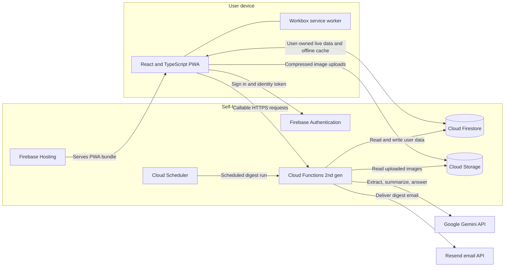
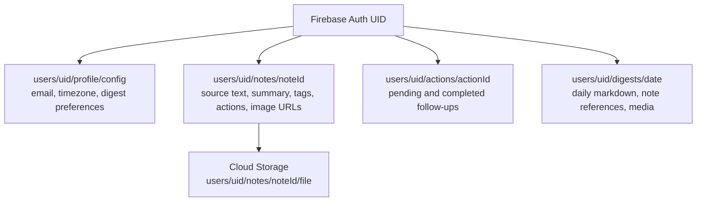
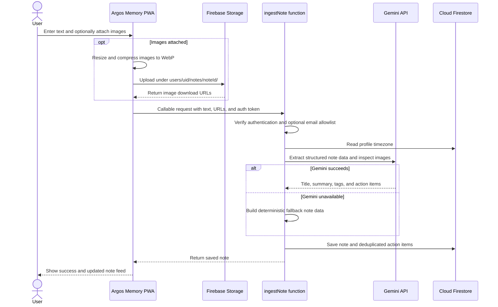
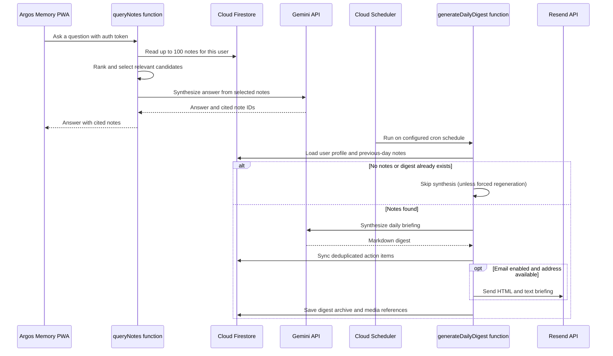

# Argos Memory Architecture

Argos Memory is a self-hosted Progressive Web App. Each deployment uses its own Firebase project and provider credentials. The browser handles capture and presentation; Firebase Functions coordinate authenticated AI processing, persistence, scheduling, and email delivery.

## System layout

## Data layout

All user records are scoped below the Firebase Authentication UID. Firestore and Storage rules restrict client access to that user's records, and callable functions require an authenticated user. Note ingestion, search, and digest operations also apply the optional server-side email allowlist.

## Note capture and ingestion

Text is sent to `ingestNote`. Images are resized and compressed in the browser, uploaded directly to Storage, then passed to the function as download URLs. Gemini extracts a title, summary, tags, and action items. If Gemini is unavailable, a deterministic fallback still allows the note to be saved.

## Search and daily digest processing

`queryNotes` loads a bounded pool of the user's recent notes (or notes in the requested date range), ranks candidates locally, and asks Gemini to answer using those candidates. The daily digest function runs on its configured schedule, skips dates with no notes, synthesizes a briefing, syncs action items, optionally sends email, and saves the digest archive.

## Security and deployment boundaries

- Intended for personal, single-user (or small trusted-household) self-hosted Firebase deployments rather than public multi-tenant SaaS hosting.
- The deployment owner operates Firebase, Gemini, and Resend accounts and pays any applicable usage charges.
- Firebase Auth identifies users. Firestore and Storage security rules scope direct client access to the authenticated user's UID; for personal instances, configure `ALLOWED_EMAILS` / `VITE_ALLOWED_EMAILS` and consider disabling open sign-ups in Firebase Authentication after creating your account.
- Callable functions validate authentication. Note ingestion, search, and digest operations also enforce `ALLOWED_EMAILS` when configured.
- Gemini and Resend credentials stay in Firebase Secret Manager for deployed functions. Emulator secrets are stored locally and excluded from Git.
- The PWA uses Workbox for application asset caching and Firestore's persistent local cache for offline data access.
