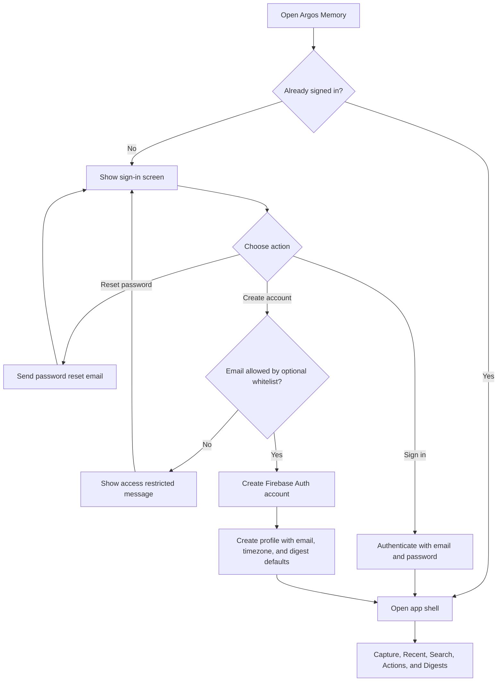
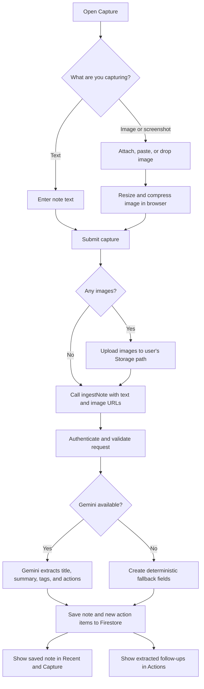
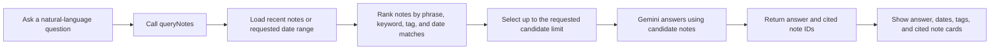
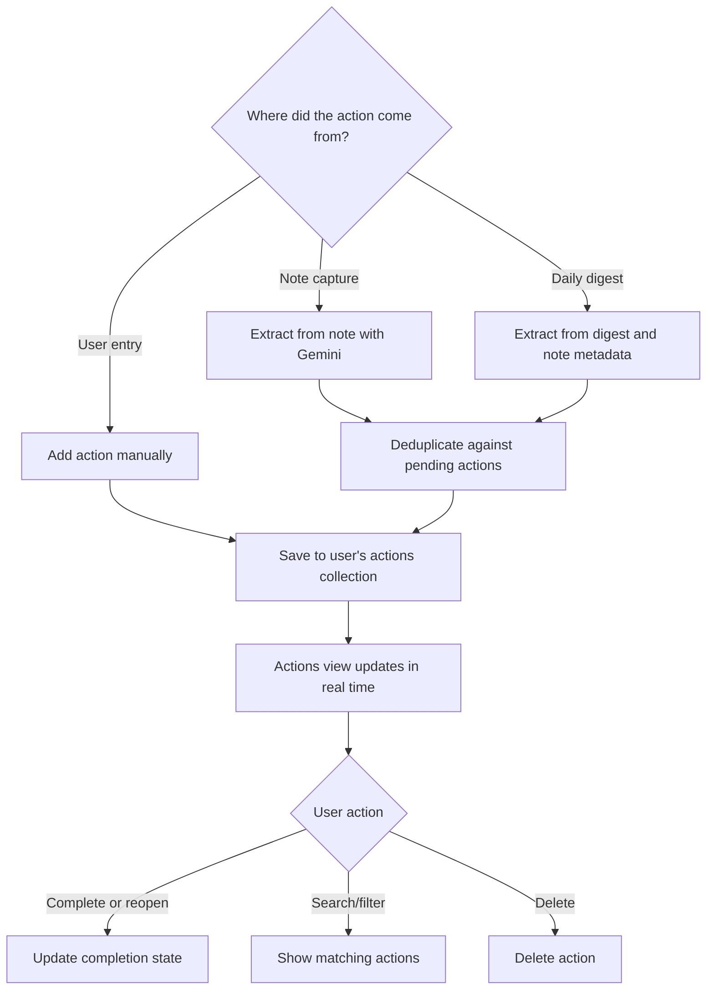
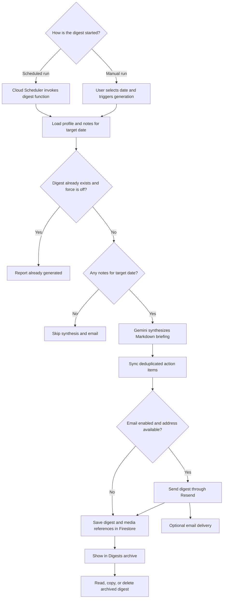

# Argos Memory User Workflows

These diagrams show the main actions available to a user after opening their self-hosted Argos Memory instance.

## Sign up, sign in, and profile setup

New accounts use Firebase Email/Password authentication. Registration can be restricted with the optional frontend email allowlist. The app creates a per-user profile with the account email, detected timezone, a 6:00 AM digest hour, and email notifications enabled by default.

## Capture a note or image

Users can type text, attach images, paste screenshots, or drag and drop images. The app compresses images in the browser before uploading them. Once saved, extracted action items appear in the Actions view as well as on the note.

## Find something from memory

Search uses a bounded note candidate set, not the entire account history. The function ranks matching notes, asks Gemini to synthesize an answer from those notes, and returns the sources so the user can check the context.

## Review and manage action items

Action items can be extracted during note capture or discovered while a daily digest is generated. Users can also add tasks manually, mark them complete, filter/search them, or delete them.

## Daily digest and archive

At the configured schedule, the backend considers each user's timezone and previous-day notes. A zero-activity day is skipped. Users can also trigger a digest for a selected date from the Digests view; existing digests are skipped unless force regeneration is enabled.

